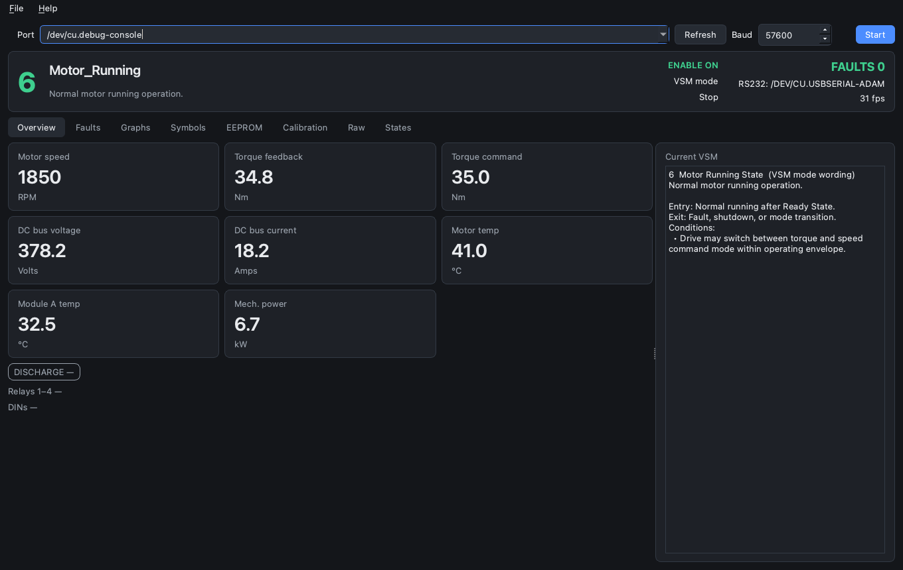
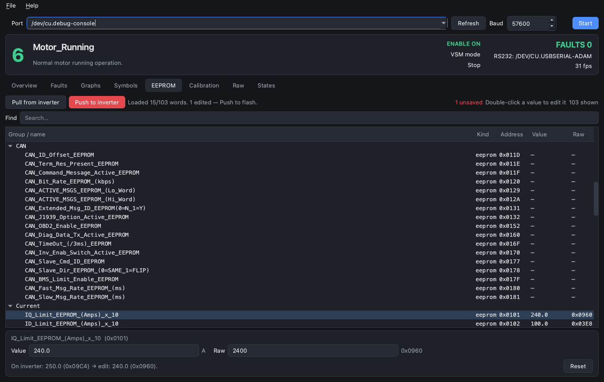
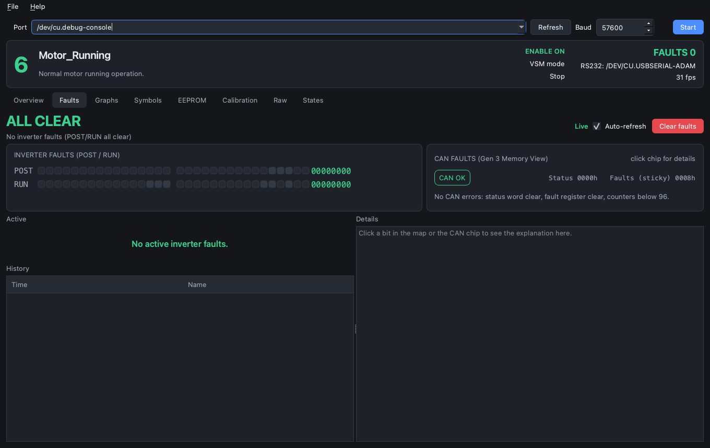

# PM100 Inverter Monitor

Live telemetry monitor and configuration tool for Cascadia Motion / Rinehart **PM100** series inverters (PM100, PM100DX, PM100DZ, etc.) over **RS232** (Memory View).

Cross-platform (macOS, Linux, Windows), built with PySide6 and pyqtgraph.



---

## Features

- **RS232 Memory View Protocol**:
  - High-rate live parameter polling (`rm`) and memory writes (`wm`) at 57600 8N1 via isolated USB–RS232 converter (e.g. ADAM-4562, FTDI, Prolific).
- **Live Telemetry & Diagnostics**:
  - Real-time vehicle dynamics (motor speed, commanded & feedback torque, mechanical power).
  - Electrical status (DC bus voltage, DC bus current, phase currents).
  - Thermal monitoring (motor temperature, inverter module temperatures, gate drive board).
  - Digital I/O, relay states, and live Vehicle State Machine (VSM) operating modes.
  - Multi-channel time-series plotting via pyqtgraph with searchable signals and persistent zoom.
- **EEPROM Parameter Management & Tuning**:
  - Full parameter map dump grouped logically (Identity, Firmware, Motor/Resolver, Current Limits, Voltage/Flux, Thermal, Accel/Torque, Speed, PID, etc.).
  - In-place cell editing with engineering unit and valid range validation.
  - Real-time diff review of staged modifications before flashing.
  - Guarded **Push to Inverter** with interlocks (requires VSM Wait and Inverter Disabled).
- **Resolver Calibration**:
  - Real-time RAM iteration of resolver `Delay Command` (`0x0005`) and `Gamma Adjust` (`0x0010`) via `wm`.
  - Optional **Program EEPROM** commit to save calibrated resolver offsets permanently.
- **Fault Management**:
  - Real-time bit-level decoding of 64-bit POST and RUN fault registers.
  - Hardware status registers and error counters.
  - One-click **Clear Faults** command (`wm0002=0000`).

---

## Screenshots

### Live Telemetry Overview
Real-time dashboard showing inverter state, motor RPM, torque command and feedback, bus electricals, and temperature monitoring.


### EEPROM Parameter Configuration
Structured parameter tree displaying engineering values alongside raw hex words, dirty change tracking, and guarded non-volatile flashing.



### 64-Bit Fault Diagnostics
Active POST and RUN fault decoding with status bit indicators and immediate fault clearing.



---

## Quick Start

### Prerequisites

- **Python 3.10+** (managed automatically if using `uv`)
- **Serial Adapter**:
  - ADAM-4562 isolated USB–RS232 converter (Prolific PL2303) or standard USB-to-RS232 serial cable.
  - On macOS with ADAM-4562: Install [PL2303 Serial](https://apps.apple.com/us/app/pl2303-serial/id1624835354?mt=12) from the App Store.
  - On Windows: Prolific / Advantech VCP driver (`COMx`).
  - On Linux: kernel `pl2303` driver (`/dev/ttyUSB*`).
  - *Note*: Close RMS GUI before connecting — serial port access is exclusive.

### Running with `uv` (Recommended)

Install [`uv`](https://docs.astral.sh/uv/) if not already installed, then run:

```bash
./run.sh
```

On Windows:

```bat
run.cmd
```

Or invoke directly:

```bash
uv run inverter-monitor
```

First run automatically downloads Python and all dependencies into an isolated environment.

### Running without `uv`

Using standard Python virtual environments:

```bash
# macOS / Linux
python3 -m venv .venv
source .venv/bin/activate
pip install -e ".[dev]"
inverter-monitor
```

```bat
:: Windows
py -3.12 -m venv .venv
.venv\Scripts\activate
pip install -e ".[dev]"
inverter-monitor
```

---

## Command Line Options

```text
usage: inverter-monitor [-h] [--serial PORT] [--baud BAUD]

PM100 inverter monitor and configuration tool

options:
  -h, --help     show this help message and exit
  --serial PORT  Live RS232 Memory View (COM3, /dev/cu.*, …). Polls watched symbols with rm
  --baud BAUD    RS232 baud rate (default: 57600)
```

You can select and refresh serial ports interactively from within the application header bar.

---

## Safety & Write Contract

The application is engineered with strict safety constraints for bench and dyno testing:

- **Continuous Reading**: RS232 Memory View reads continuously using `rm` polls.
- **Guarded Writes**: Write commands (`wm`) are strictly restricted to:
  - **Clear Faults** (`wm0002=0000`) on explicit confirmation in the Faults tab.
  - **Resolver Tuning** (RAM writes of Delay Command `0x0005` and Gamma Adjust `0x0010` in Calibration).
  - **Calibration Commit** (copying Delay/Gamma into EEPROM addresses `0x0118`/`0x011A` and issuing commit pair `wm0000=5a0f` / `wm0001=0059`).
  - **EEPROM Push** in the EEPROM tab: Writes each modified EEPROM parameter followed by the commit pair. Requires safety interlocks: the inverter must be in **VSM Wait (4)** and **Inverter Disabled (0)**, and the user must inspect and confirm the staged diff in a dedicated dialog.

---

## Repository Structure & Reference Data

| Path | Description |
|------|-------------|
| `data/defsyms.yaml` | Memory View symbol map and addresses (`defsyms_20221118_G3.txt`) |
| `data/vsm_states.yaml` | Vehicle State Machine & Inverter Mode states and descriptions |
| `data/faults.yaml` | Detailed diagnostics text for POST and RUN faults |
| `data/reference_decode.yaml` | Diagnostic bitfield definitions and SCI column map |
| `docs/images/` | Application UI screenshots and visual references |
| `docs/rms-gui-memory-view.md` | Reverse-engineered `rm`/`wm` Memory View protocol documentation |
| `docs/architecture-notes.md` | Architecture and stack design notes |
| `docs/okf/` | Knowledge documentation bundle for PM100 inverters |
